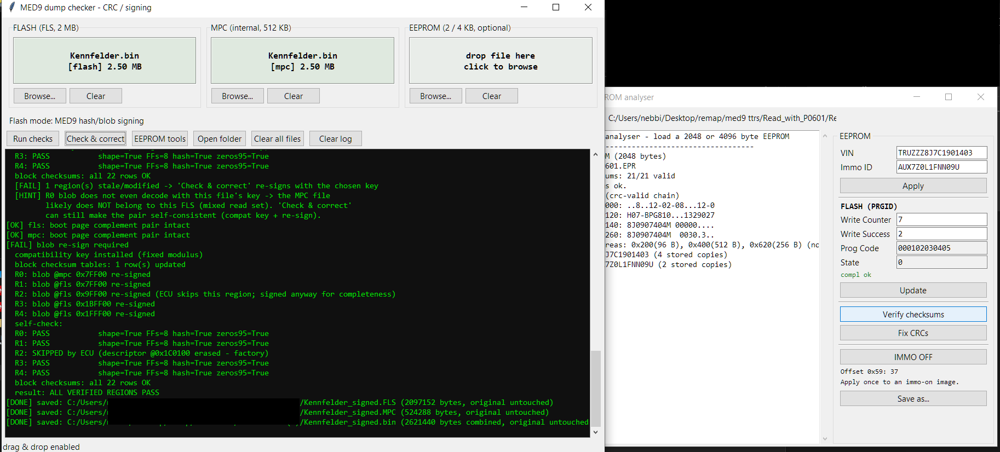

# MED9 Checker

Windows x64 utility for inspecting supported MED9 flash and EEPROM images.
The GUI identifies supported checksum and signing layouts from the flash data.
EEPROM tools support 2 KiB and 4 KiB images.



## Run

Open `MED9Checker.exe` from the Windows release. The executable contains the
Python runtime, Tk, and the C backend DLL for fast hashing.

To run from source with Python 3.10 or later and Tk installed:

```powershell
python scripts/med9_checker.py
```

`tkinterdnd2` is optional for drag and drop.

## Build

Install x64 Python with Tk, PyInstaller, and the MSVC x64 C++ build tools.
Install `tkinterdnd2` in the build environment to bundle drag and drop.

```powershell
python -m pip install pyinstaller
python build_release.py
```

The builder compiles the C backend, compares it against the Python
implementation, and tests the one-file executable with generated input.
The result is `dist/MED9Checker.exe`.

## Files

- Flash browsing supports FLS, BIN, ORI and MOD.
- EEPROM browsing supports EEP, EPR, E2P and BIN.
- Checksum-only flash correction accepts a supported flash image by itself.
- Signing operations require the matching MPC image.
- The checker writes corrected flash images as separate output files.

## License

The original project code is available under the [MIT license](LICENSE).
See [third-party notices](THIRD_PARTY_NOTICES.md) for bundled components and
reverse-engineered material.

## Privacy

The checker processes files locally and stores your last browse folder on
your computer. See the [privacy policy](PRIVACY.md) for details.

## Release notes

- [v0.1](RELEASE_NOTES_v0.1.md)
